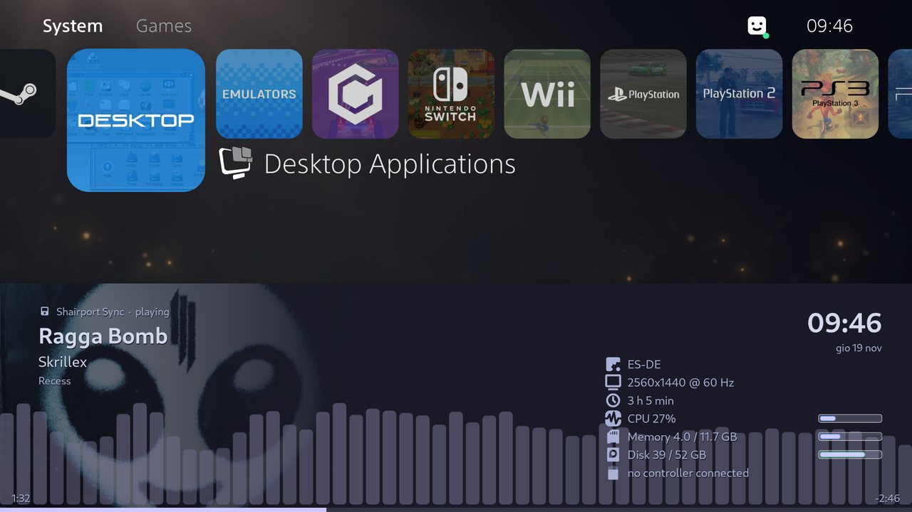
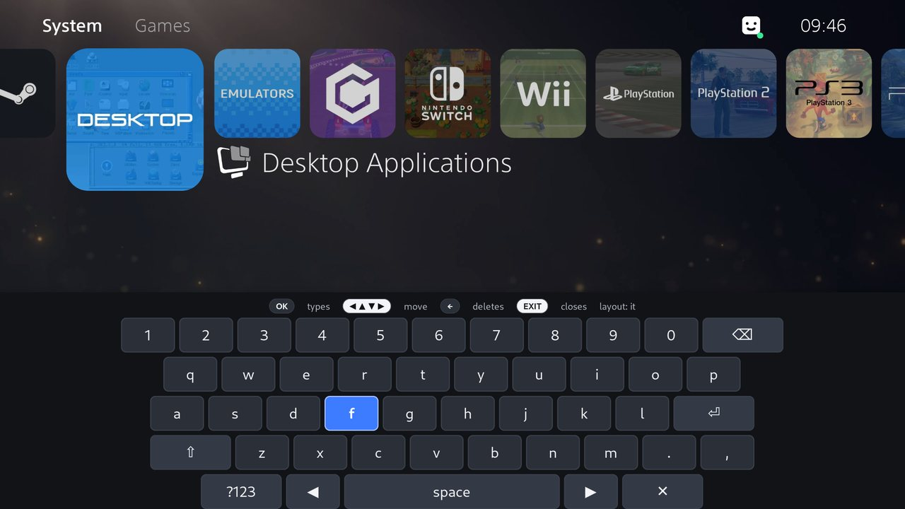
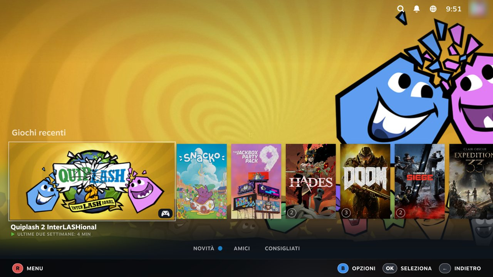
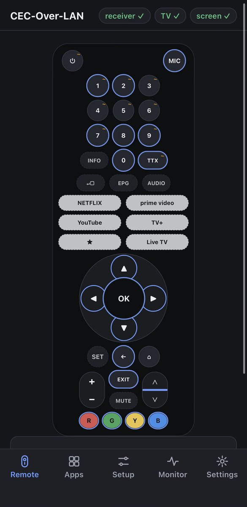
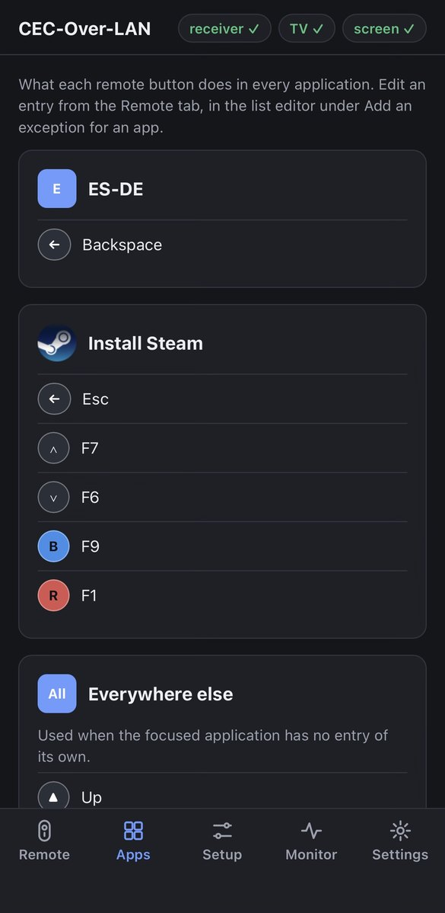
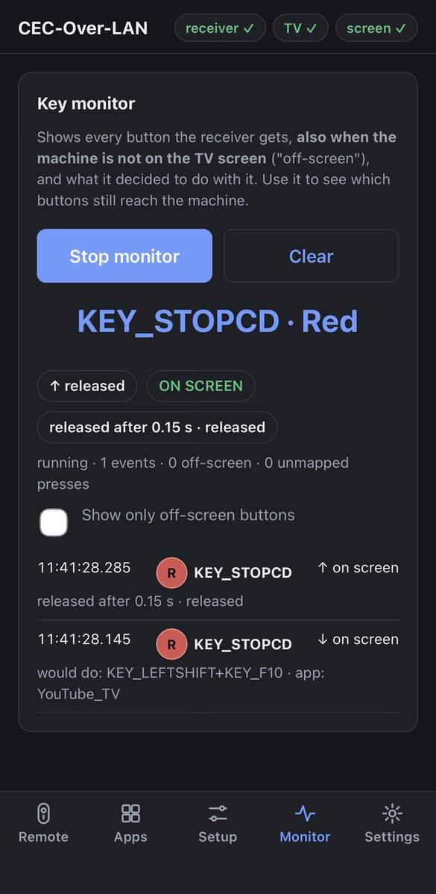
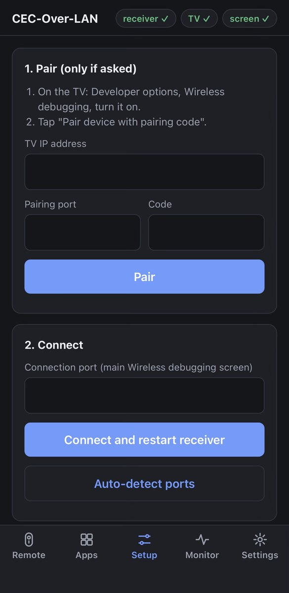
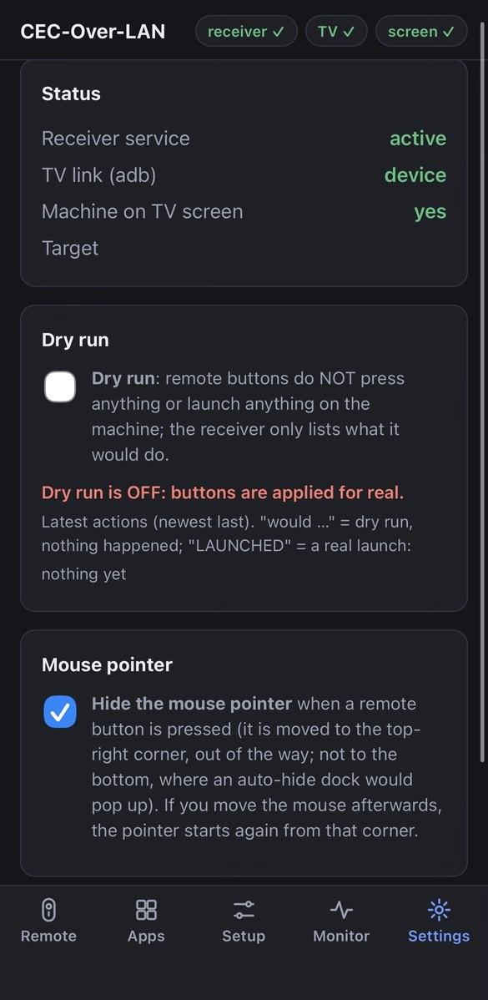

<h1 align="center">CEC-Over-LAN</h1>

<p align="center"><b>Drive a Linux machine with the remote of your Android TV, over the LAN.</b></p>

Use the physical remote of an Android / Google TV as an input device for a Linux VM (or PC) connected to the TV over HDMI, when you don't have a CEC-capable device (practically no GPU on the market has a CEC chip). The key presses travel over the LAN and the machine injects them only while the TV is showing it. On top of that the machine draws what a screen driven by a remote needs: an on-screen keyboard, an info panel (what plays, the window in front, how the machine is doing), Steam hints with your remote's own buttons, mouse actions, per-application rules, and a phone page to set it all up.

How it works:

1. **A source delivers the remote's keys to the machine.** Either the **TV app** (`android/`: an accessibility service that sends the keys over TCP; `adb` is needed once, to install it) or **adb** itself (`adb shell getevent -l` over wireless debugging, the fallback). With `--source auto` the app is used while it is connected.
2. `receiver/tv_remote.py` translates the keys with the keymap (per key: a tap, a long press, exceptions per application; the actions are keys, applications, web pages, the on-screen keyboard, the info panel and the mouse) and injects them into a `uinput` device ("TV Remote (CEC-Over-LAN)").
3. The machine sees a normal keyboard and mouse: ES-DE, Kodi, Steam and GNOME react to it.
4. **Keys are injected only while the TV is showing the machine.** The app works that out from the window in front on the TV; adb reads `mActiveRoutingPath` from `dumpsys hdmi_control` (`0x1000` = HDMI 1, configurable with `--active-path`). When you use the TV for anything else, no key reaches the machine; while the machine is shown, the app keeps the keys from the TV (Power, Home and Volume still go to it).
5. A page for your phone pairs the TV, shows a live key monitor and lets you bind every button on a drawing of your own remote, made from a photo with an AI prompt.

Tested on: Debian 13 with GNOME Shell 48.7, a Xiaomi `MiTV-MZTU0` (Android 14), a 20 m fibre-optic HDMI cable. The full test report is in [REPORT.md](REPORT.md).

## On the machine

<p align="center">



</p>

What the machine shows, left to right: the info panel (`info:show`: what plays, the window in front, the machine's state), the on-screen keyboard (`osk:toggle`), and Steam Big Picture where the hints "Enter" and "Esc" become the remote's own OK and Back (the red and blue buttons show as such). Pictures taken on the machine itself, at 2560x1440.

## Support and limitations

**One command to adapt it:** paste [`docs/ADAPT-PROMPT.md`](docs/ADAPT-PROMPT.md) into an AI agent that can run commands on your computer. It checks your system, installs the receiver and the GNOME extension, builds your remote from a photo (`receiver/web/remote-prompt.md`), fits the TV app to your TV (a *TV profile* in `android/profiles/`), and reports what does not work.

**Supported systems.** The computer: Linux with **GNOME Shell 48 to 51 on Wayland**: tested on Debian 13 with GNOME 48.7 only; 49 to 51 are expected to work (the extension lists them and uses only long-standing Shell APIs) but have not been tried. Other desktops are not supported yet; KDE Plasma Bigscreen may follow. The GNOME-specific parts are: the `desktop/gnome/focuspid@claude` extension (focus restore, per-app rules, the window in front), the screen mode read from Mutter (D-Bus `org.gnome.Mutter.DisplayConfig`), the accent colour and colour scheme from GSettings, and the GTK 3 windows (keyboard, info panel) shown through Xwayland. A Plasma port would need replacements for those four. The TV: Android TV / Google TV, Android 11 or newer (the pairing of Wireless debugging), with the computer on **the TV's own HDMI input**. Tested on one TV only: Xiaomi MiTV-MZTU0, Android 14.

**Limitations.**

- **One TV tested.** The remote prompt and the profile are how it is meant to adapt; nothing else has been tried on another maker's TV.
- **"Is the computer on screen?"** The adb source reads `dumpsys hdmi_control` and tells HDMI ports apart; the TV app cannot (it sees that the Live TV app is in front), so it takes any HDMI input for the computer's. The app's guess also needs a profile for each maker (the package that hosts the HDMI inputs); an overlay without a focused element would be missed. Home is the way out if the guess is wrong.
- **Not supported:** Android boxes (Chromecast, Shield, Fire TV: the computer is not on their HDMI input), Android older than 11 (no pairing; `adb connect <ip>:5555` may work), X11 sessions (untested), other desktops (above).
- **Keys.** While the computer is shown the app consumes the keys so the TV shows nothing of its own; Power, Home, Volume and Mute always go to the TV and also reach the computer (if you bind one of them, both act). Buttons the TV handles below Android's input layer (voice, some app shortcuts) may never reach the app; not every button has been checked.
- **Security.** The receiver and the app talk plain TCP on the LAN: the port accepts only private addresses and the shared token, but the token travels unencrypted, and it is written into the APK. Use it on a LAN you trust. The web UI has the same model.
- **Info panel.** It needs a running PipeWire (the spectrum shows what the computer plays, flat otherwise), numpy, and an MPRIS player for the media part. A pad that reports no battery (a 2.4 GHz receiver, a wired pad) is listed by name only.
- **The TV app needs adb once**, to install and enable it. After that adb is only the fallback; a lost accessibility service (an update, a TV reset) needs it again.

## Default mapping

| Remote | Event read | Injected on the machine |
|---|---|---|
| Arrows | `KEY_UP/DOWN/LEFT/RIGHT` | arrows |
| OK | `KEY_SELECT` | Enter |
| Back | `KEY_BACK` | Backspace |
| Channel up / down | `KEY_CHANNELUP/DOWN` | next / previous media |
| Red | `KEY_STOPCD` | Home (`KEY_HOMEPAGE`) |
| Green (hold 3 s) | `KEY_EJECTCD` | Alt+F4 |
| Yellow | `KEY_SHUFFLE` | Super (GNOME overview) |
| Blue | `KEY_SEARCH` | Play/Pause |

This is only the default: the mapping can be edited from the web UI (below), numbers included.

Volume is left to the TV. The physical Home key reaches `getevent` but is not mapped (the TV uses it to leave the input). Mute and Assistant were not observed.

## Requirements

- On the TV: Android / Google TV 11 or newer, with Developer options and Wireless debugging enabled by the owner (to pair, and to install the TV app once).
- On the machine: GNOME Shell 48 to 51 on Wayland (see *Support and limitations*), `adb` (`android-tools-adb`), Python 3 with `python-evdev` and PyGObject (GTK 3), write access to `/dev/uinput` (via an ACL here). Optional: `avahi-utils` (finds the TV's port by itself), PipeWire with `pw-record` and `numpy` (the spectrum of the info panel).

## Usage

```bash
adb pair <TV_IP>:<PAIRING_PORT> <CODE>      # once
adb connect <TV_IP>:<PORT>
python3 receiver/tv_remote.py --target <TV_IP>:<PORT> --dry-run   # print only
python3 receiver/tv_remote.py --target <TV_IP>:<PORT>             # inject, only while the machine is on screen
python3 receiver/tv_remote.py --target <TV_IP>:<PORT> --no-gate   # always inject
```

As a service: see `receiver/tv-remote.service` (user unit, `Restart=always`).

## Pairing from a phone (web UI)

After a TV reboot or standby the wireless debugging port and pairing are lost (T4/T6). `receiver/tv_remote_web.py` serves a small mobile page on the LAN to redo them from a phone:

```bash
cp receiver/tv-remote.service receiver/tv-remote-web.service ~/.config/systemd/user/
mkdir -p ~/cec-over-lan && cp -r receiver/* ~/cec-over-lan/
echo 'TV_TARGET=<TV_IP>:<PORT>' > ~/cec-over-lan/tv-remote.env
systemctl --user daemon-reload && systemctl --user enable --now tv-remote tv-remote-web
cat ~/cec-over-lan/token          # access token, created on first start (mode 0600)
```

<p align="center">





</p>

Open `http://<machine-ip>:8765/?t=<token>` on the phone once (the page remembers the token). Then: enter the pairing port and code, tap *Pair*, enter the connection port, tap *Connect and restart receiver*. The page also shows the service state, the adb link and whether the machine is on the TV screen.

### Steam button icons

Steam's Big Picture draws its hints as keyboard keys ("Esc BACK", "Enter SELECT", "F1 MENU") because the remote reaches it as a keyboard. `receiver/steam/steam_glyphs.py` replaces each key cap with the button of the remote that sends that key, according to your mapping: where Back sends `Esc`, "Esc BACK" shows the remote's back arrow; a button bound to `F1` shows its own icon. The per-app exception for `steam` is the one that counts (Steam is the focused app). Only single-key taps are drawn; long presses and combinations have no key cap.

It changes no file of Steam: a script is injected into the running UI through the DevTools port, so **Steam must be started with `-cef-enable-debugging`** (the `.cef-enable-debugging` file is *not* honoured by this Steam; the option is). `steam-glyphs.service` (user unit) re-injects after a Steam restart or a mapping change. `steam_glyphs.py --map` prints the computed map, `--dump` the key caps Steam shows right now (Steam translates some names: in Italian Enter is "Invio"; send the output of `--dump` to add a missing name), `--remove` puts the keyboard keys back. `receiver/steam/cdp.py` is a small standard-library DevTools client (localhost only).

### The web UI on a phone

The page has five tabs (bottom bar) and a status strip on top (receiver, TV link, machine on screen, DRY RUN):

- **Remote** — a drawing of the remote (layout from `receiver/web/remote.json`, taken from a photo of the Xiaomi remote). Tap a button to open the binding sheet; press a button on the real remote and it lights up. Buttons with a ring have a binding, dashed ones have a code that is not known yet, a tilde marks a guessed code. The drawing is scaled to fit the free height of the phone screen, so the whole remote is visible without scrolling. The old list editor is still there under *All bindings*.
- **Apps** — what each button does in every application, one card per application with its name and icon from the `.desktop` file (an exception written as `es-de` is matched to the installed application by id, name or window class), plus a card for the buttons' default actions. Each line starts with the button's glyph, drawn like the buttons in Steam's hints.
- **Setup** — pairing, connection and the setup wizard.
- **Monitor** — the live key monitor.
- **Settings** — status details, dry run, mouse pointer, receiver service.

**The port follows the TV.** Wireless debugging picks a new random port every time it is switched on (the kernel chooses it from its ephemeral range, 32768 to 60999 on Android), but the pairing survives. The TV announces the port over mDNS as `_adb-tls-connect._tcp` (and `_adb-tls-pairing._tcp` while the pairing dialog is open), as the adb documentation describes ([`docs/dev/adb_wifi.md`](https://android.googlesource.com/platform/packages/modules/adb/+/refs/heads/main/docs/dev/adb_wifi.md) in the AOSP sources). So after you switch Wireless debugging back on, nothing has to be typed: when `adb connect` fails the receiver asks Avahi (`avahi-browse -rpt _adb-tls-connect._tcp`, installed with `avahi-utils`; adb's own `adb mdns services` is empty on many Linux machines) for the port of the TV at the same address, switches to it, saves it in `tv-remote.env` and carries on. While Wireless debugging is off it retries every 30 s at most. *Auto-detect ports* in the Setup tab uses the same lookup. Only a lost pairing (revoked on the TV) needs the code again.

**Your own remote.** The drawing is the Xiaomi Google TV remote. For any other remote, open *Setup* → *Your remote* → *Show the prompt to copy* (the text is `receiver/web/remote-prompt.md`), paste it into a chat with your AI together with a well-lit photo of the remote, and paste the JSON it answers with into the box. The page checks it (button ids, shapes, that the layout only uses known buttons, that no two buttons share a key code) and says what is wrong if it is not valid; a fenced code block is accepted as it is. The result is stored in `~/cec-over-lan/remote.json`; *Back to the built-in remote* removes it. Codes the AI is not sure of are `null`: press the button on the real remote and use *Learn*. The format is documented in the prompt itself.

**The binding sheet needs no typing.** It sets, per button: *Tap* or *Long press* (with a hold-time stepper), and an action chosen with taps: **Keys** (modifier toggles Super/Ctrl/Alt/Shift plus pages of keys: letters, digits, navigation, F1–F12, media), **App** (search the installed applications), **Website** (presets or a URL), **Keyboard** (the on-screen keyboard) or *Nothing*. A scope row switches between *Everywhere* and *only in an app* (the apps seen recently are offered, see Per-app exceptions). **Learn** associates a drawn button with the code of the real one: press it on the remote and the code is saved in `~/cec-over-lan/remote-learned.json` (a code belongs to one button). A website address is the only thing that may need typing.

The codes in `remote.json` come from this project's logs and tests; the ones marked `guess` (digits other than 0 and 8, TTX, power) were deduced and may need Learn, and the buttons with `null` (INFO, EPG, AUDIO, source, mic, Netflix, Prime Video, YouTube, TV+, star, Live TV, settings, mute) were never observed.

### Dry run

The *Dry run* card has a switch: while it is on (a file `~/cec-over-lan/dry-run` exists; the receiver checks it twice a second, no restart), pressing a remote button presses **nothing** and launches **nothing** on the machine. The receiver only logs what it would do, and the card lists it ("would press KEY_ENTER", "would launch app kodi.desktop"); real launches are listed as "LAUNCHED". A key that is already held down when you switch it on is still released, so nothing can stay stuck. `--dry-run` on the command line is the permanent version.

### Writing key combinations

Where an action is a key or a combination you can write the evdev names (`KEY_LEFTMETA+KEY_S`) or the names people use: `Super+S`, `Win+Q`, `Ctrl+Alt+Tab`, `alt+f4`, `escape`. They are converted to the canonical evdev form when saved. `Super` is `KEY_LEFTMETA` (there is no plain `KEY_META` key in Linux, but `KEY_META` is accepted as an alias). Up to 4 keys; power-type keys are refused. An invalid name is reported with a suggestion: `unknown key 'KEY_LEFTMETAA' (did you mean KEY_LEFTMETA, …?)`.

### Per-app exceptions

Every key can have exceptions that apply only while a given application has the keyboard focus, e.g. *Back* sends `Esc` (what GNOME wants) but `Backspace` in ES-DE, where `Esc` opens the main menu:

```json
"KEY_BACK": {"tap": "KEY_ESC", "apps": {"es-de": {"tap": "KEY_BACKSPACE"}}}
```

The text is matched, case-insensitively and as a substring, against the window class, the application id, the window title and the process name; the first matching exception replaces the whole action of that key. The focused window comes from the GNOME Shell extension `focuspid` (D-Bus `org.claude.FocusPid`, shipped on the test machine, not in this repository): without it, exceptions simply never match. The *Key monitor* shows the app name seen at each press, which is the easiest way to find the text to use. The action chosen at the press is the one used at the release, even if the focus changes in between.

### Esc gives the focus back after the dock

`Ctrl+Alt+Tab` focuses the dock by taking the keyboard focus away from every window, so afterwards `Esc` closes nothing and the arrows keep driving GNOME. When a remote button sends `Esc` while no window has the focus (the dock, the overview, a shell menu), the receiver gives the focus back to the last window that had it (`ActivatePid` of the `focuspid` extension), about a quarter of a second after the `Esc`, so the arrows go to the application on screen again. It does nothing in dry run, and nothing if no window was ever seen. The same happens when the button sends `Backspace` or `Alt+F4` (Back and Exit in the default mapping) while no window has the focus: neither closes the dock, so the receiver sends `Esc` instead (log: `esc-closes-overlay`). With a window focused they are sent unchanged.

### On-screen keyboard

`osk:toggle` (action type *Keyboard* in the editor, "On-screen keyboard" in the *Desktop and media* wizard list) opens a keyboard on the screen, driven by the remote: **arrows move the highlight, OK types the key, Back deletes the last character, Exit closes it**; the toggle button closes it too. The top line of the keyboard shows these buttons as glyphs. While it is open the remote's D-pad goes to the keyboard instead of being injected into the application.

- The window is an Xwayland dock-type window that never takes the keyboard focus, so the text goes to the application that was in front (checked on the test machine: the focused window is the same before, while and after). The panel is as wide as the screen and sits flush with the bottom edge (no margin below); the keys keep their size (one unit is 0.66/22 of the screen width, so a letter key is 2 units) and stay centred on it.
- It types with a virtual keyboard of its own, so the machine's layout matters. Italian (`it`) and US (`us`) tables are included; the layout is read from GNOME (`org.gnome.desktop.input-sources`) or forced with `CEC_OSK_LAYOUT=it|us`. The Italian punctuation table was written from the xkb `it` layout and still has to be checked by typing every symbol.
- Layers: letters, one-shot capital (⇧), digits and symbols (`?123`), plus space, backspace, enter and cursor left/right.
- Needs `python3-gi` with GTK 3 and write access to `/dev/uinput`. `CEC_OSK_SNAPSHOT=/path.png` saves a picture of the window, for diagnostics.

### GNOME shell and dock shortcuts

The wizard has a *GNOME shell and dock* list with the shortcuts read from the test machine (GNOME Shell 48.7 with dash-to-dock): quick settings menu (`Super+S`), notifications (`Super+V`), application grid (`Super+A`), the dock's numbers overlay (`Super+Q`, 2 s, no focus), launch/switch to dock icon N (`Super+1…9`) and "focus the dock" (`Ctrl+Alt+Tab`: dash-to-dock registers itself in GNOME's system-controls switcher, after which the arrows move over the icons). The last one has not been verified with a single tap of a remote button.

### Mouse pointer

On a machine that is shown on a TV the mouse pointer is just in the way. When a remote button is pressed (and the machine is on the TV screen, not in dry run) the receiver moves the pointer to the **top-right** corner, where most of the cursor image hangs off the screen, using a second virtual mouse ("TV Remote pointer mover"). If you move a real mouse afterwards the pointer starts again from that corner.

The corner matters. The first version parked the pointer at the bottom-right, and with a bottom dock that auto-hides (dash-to-dock, `extend-height`, `require-pressure-to-show`) every remote press pushed the pointer against the bottom edge, which reveals the dock, and the pointer then stayed over it so it never hid again. Top-right is clear of that and of GNOME's hot corner (top-left). `--pointer-corner top-right|bottom-right|top-left|bottom-left` changes it. It is on by default; the *Mouse pointer* card in the web UI switches it off (a file `~/cec-over-lan/pointer-visible` exists while it is off), `--no-hide-pointer` disables it permanently. It needs no desktop extension and no session restart.

### Key monitor

The *Key monitor* card (press *Start monitor*) shows every remote button the receiver gets, as it happens: the button in big letters, whether the machine was **on screen or off screen** when it was pressed, what the receiver decided to do with it (applied, only a dry run, ignored because off-screen, unmapped, waiting for a long press) and, on release, how long it was held and what happened. Rows pressed off-screen are red and can be filtered. It is meant for analysis: the receiver reads the remote below Android's UI, so it sees buttons even when the TV is showing something else; those are never applied (`decision=off-screen`).

The same information is in the service log, one line per event:

```
[seen] KEY_SELECT DOWN screen=yes decision=tap:KEY_ENTER dry=no
[seen] KEY_SELECT UP screen=yes held=0.20 result=released
[seen] KEY_EXIT DOWN screen=no decision=off-screen dry=no
```

Right after the receiver starts, the first source check takes about a second: buttons pressed in that moment are reported as off-screen.

### Setup wizard

The *Setup wizard* card walks through the whole mapping in four steps, so you never have to know the key names:

1. **Discover**: press every button on the remote. Nothing is recorded or changed; the page only shows which buttons exist (with a counter) and what the machine receives. A button that never shows up is consumed by the TV and cannot be used.
2. **Assign**: pick the command lists to go through (ES-DE, Desktop and media, Number keys 0-9; defined in `receiver/web/profiles.json`, the ES-DE one comes from its user guide). For each command the page asks you to press the remote button you want for it. Skip and Back are available; a button already used for the same kind of action is refused.
3. **Shortcuts** (optional): press a button, then bind it to an installed **application** or a **website**, on tap or on long press.
4. **Review and save**: replace the current mapping or add to it.

The first screen has a **Test run** checkbox (on by default): the wizard goes through every step but writes nothing; the last step only shows what would be saved. Untick it to save for real. Steps 1 to 3 never write anything anyway.

### Key mapping

The *Key mapping* card edits `~/cec-over-lan/keymap.json`, which the receiver reloads by itself within a second (no restart):

- Press a key on the remote with the machine on screen: it appears as a chip under the card title; tap it to add a row. *Add numbers 0–9* adds the ten digits.
- **Tap** is what is done on the machine. An action is one of:
  - keys, or a combo joined with `+`, e.g. `KEY_LEFTCTRL+KEY_C`;
  - `app:<file>.desktop`: launch an installed application (`gio launch`), chosen from the list of installed `.desktop` files;
  - `url:https://…`: open a web page with the default browser (`xdg-open`). Only `http://` and `https://` are accepted.
  - `info:show`: a panel as wide as the screen, for 8 seconds (`receiver/tv_info.py`); used again while it is open, it closes. It closes by itself after 8 seconds, except while music plays and no application is in front (ES-DE and the desktop do not count): then it stays until the action is used again (or something comes to the front). Behind everything: the artwork (square for music, 16:9 for video, black bars cut) over the left 40 % of the panel and faded out to the right , a spectrum of what the machine plays (`pw-record` on the output's monitor and numpy; flat without them or in silence) with rounded bars across the whole width, and the progress of the song as a bar along the bottom edge, with the time played at the left end and the time left at the right end. In front, from the left edge over the artwork and towards the top: the player's icon, title (up to three lines, so long YouTube titles show whole), artist and album; on the right the window in front with its own icon, the screen mode as the compositor drives it, uptime, CPU, memory and disk as bars, the game controllers that are connected (by name, with the battery where the kernel reports one: a 2.4 GHz receiver or a wired pad reports none), the time. The colours are those of your GTK theme (`window-bg-color`, `window-fg-color`, `accent-bg-color`, which a theme manager such as Rewaita writes) and, where it names none, GNOME's accent colour and dark/light setting; the text is pushed towards white (or black on a light theme) until it reads against the background at a contrast of at least 12, and the spectrum is a darker tint of the accent so it stays behind the text. It rises from the bottom edge fading in (0.3 s) and leaves the same way (0.25 s), also when the receiver closes it. It also closes when the TV leaves the machine (an overlay, the Home screen).
  - `mouse:<name>`: act on the receiver's virtual mouse. Names: `left`, `right`, `middle` (the button stays pressed while the remote button is held, so a long hold drags), `move-up`, `move-down`, `move-left`, `move-right` (repeat while held and speed up, 6 to 40 pixels per 30 ms) and `scroll-up`, `scroll-down` (one notch every 0.12 s while held). A press that uses a mouse action does not send the pointer to the corner. The wizard has a *Mouse* list with all of them.
  Launches happen once per press (repeats within 1.5 s are ignored) and, like keys, only while the machine is on the TV screen. Free-form commands are not accepted on purpose. Each launched program is started in its own systemd scope (`systemd-run --user --scope`), so restarting the receiver does not close it and its memory is not counted as the receiver's.
- **Long press** fires once after the **hold** time (0.3–10 s, default 3). With only a long action, a short press does nothing; with both, a short press clicks the tap action and a long one fires the long action only.
- Any `KEY_*` name known to Linux evdev can be a target (518 on the test machine). Power actions (`KEY_POWER`, `KEY_SLEEP`, `KEY_SUSPEND`, `KEY_RESTART`, `KEY_WAKEUP`) are refused on purpose.
- *Reset to defaults* deletes the file; the built-in mapping above applies again.

File format:

```json
{"version": 1, "keys": {
  "KEY_SELECT":  {"tap": "KEY_ENTER"},
  "KEY_EJECTCD": {"long": "KEY_LEFTALT+KEY_F4", "hold": 3.0},
  "KEY_8":       {"tap": "KEY_8", "long": "KEY_LEFTCTRL+KEY_8", "hold": 1.0},
  "KEY_FIND":    {"tap": "app:kodi.desktop", "long": "url:https://example.org/", "hold": 1.0}}}
```

Security: it answers only to private (RFC 1918) addresses, every API call needs the token, inputs are validated and no shell is used. Anyone who has the token can pair/connect adb, restart the service, and bind keys to launch **any installed application** or open **any http(s) address** on the machine (but not run arbitrary commands). It is meant for a trusted home LAN: do not forward its port to the internet.

## Tests

```bash
python3 -m unittest discover -s tests -v    # keymap validation, routing, long press, reload (no TV needed)
```

## The TV app (`android/`)

A small Android app with an AccessibilityService, built here without Gradle. It replaces `adb shell getevent` as the source of the remote's keys, so Wireless debugging is needed only once, to install it; after that it starts with the TV and reconnects by itself.

- **Keys:** every key press reaches the service with its raw scan code, which `android/gen_keynames.py` turns into the Linux names the keymap already uses (`KEY_STOPCD`, `KEY_SELECT`...); keys Android makes itself arrive as `KEY_ANDROID_<n>`. The remote shows up as two input devices, so the same press is reported twice; the app and the receiver each act on the first one only. Lines go over TCP (port 8766, private addresses, the token of the web UI) to `receiver/app_source.py`.
- **Is the machine on screen?** `dumpsys hdmi_control` is closed to apps (it wants audio permissions that cannot be granted), so the app reads what is in front: the TV's Live TV app hosts the HDMI inputs, so "machine shown" means Live TV in front, no tuner window, and nothing with input focus (a focused row means a menu or an overlay such as the TV's own info panel is open). It cannot tell HDMI 1 from another HDMI input. Windows and focus are read by name only; the service description says so.
- **The TV stays out of it:** while the machine is shown the app consumes the keys, so the TV shows none of its own overlays; **Power, Home, Volume and Mute always go to the TV**, which keeps a way out. With `CEC_CONSUME=false` nothing is consumed.
- **Receiver:** `--source auto` (the default of the unit) takes the keys and the gate from the app while it is connected and falls back to adb when it is not; `--source app` never starts adb. When the machine leaves the screen, the receiver closes the info panel and the keyboard.
- **Other apps' accessibility services stay:** the installer appends the service to the enabled ones (the Xiaomi launcher in use here, Projectivy, has its own).

Build and install (the SDK goes in `android/sdk/`, which git ignores):

```bash
cd android
curl -LO https://dl.google.com/android/repository/commandlinetools-linux-11076708_latest.zip   # then unzip into sdk/cmdline-tools/latest
yes | sdk/cmdline-tools/latest/bin/sdkmanager --sdk_root="$PWD/sdk" "build-tools;34.0.0" "platforms;android-34"
CEC_HOST=<this machine's address> CEC_TOKEN=$(cat ~/cec-over-lan/token) CEC_CONSUME=true ./build.sh
./install.sh <TV ip:port> build/cec-over-lan-tv.apk        # where adb is paired; push + pm install, the streamed install dropped on the Xiaomi TV
```

The address and the token are written into the APK, so keep it to yourself. The keystore is created once in `~/.config/cec-over-lan/`. Tested on one TV only (Xiaomi MiTV-MZTU0, Android 14, API 34); the gate guess depends on how that TV's Live TV app behaves.

## Known limits

- The wireless debugging port can change: after a TV reboot the old port was `offline` (see T6 in REPORT.md), so a new `adb connect` is needed.
- Behaviour with the TV in standby is not verified (T4).
- Key latency is not measured.

## Other files

- `RULES.md`, `PROMPT.md`: the rules and the task given to the agent that ran the tests.
- `STATUS.md`: test status.
