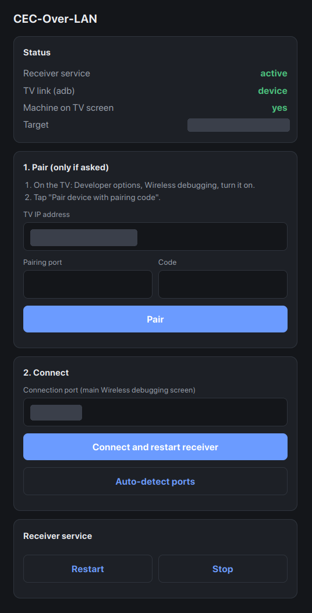

# CEC-Over-LAN

Use the physical remote of a Google TV as an input device for a Linux VM (or PC) connected to the TV over HDMI, when HDMI-CEC does not carry the keys: the key presses travel over the LAN (adb) and the receiver injects them only while the TV is showing the machine.

How it works (variant A, no app on the TV):

1. The machine connects to the TV with `adb` (wireless debugging, one-time pairing).
2. `receiver/tv_remote.py` reads `adb shell getevent -l`, translates the keys and re-injects them into a `uinput` device ("TV Remote (CEC-Over-LAN)").
3. The machine sees a normal keyboard: ES-DE, Kodi and GNOME react to it.
4. Every 1.5 s the receiver reads `mActiveRoutingPath` from `dumpsys hdmi_control` and injects only if the TV is showing the machine's HDMI port (`0x1000` = HDMI 1, configurable with `--active-path`). When you use the TV for anything else, no key reaches the machine.

Tested on: Debian 13 with GNOME Shell 48.7, a `MiTV_MZTU0` Google TV, a 20 m fibre-optic HDMI cable. The full test report is in [REPORT.md](REPORT.md).

## Default mapping

| Remote | Event read | Injected on the machine |
|---|---|---|
| Arrows | `KEY_UP/DOWN/LEFT/RIGHT` | arrows |
| OK | `KEY_SELECT` | Enter |
| Back | `KEY_BACK` | Backspace |
| Channel up / down | `KEY_CHANNELUP/DOWN` | next / previous media |
| Red | `KEY_STOPCD` | Home (`KEY_HOMEPAGE`) |
| Green (hold 3 s) | `KEY_EJECTCD` | Alt+F4 |
| Yellow | `KEY_SHUFFLE` | Super (GNOME overview) |
| Blue | `KEY_SEARCH` | Play/Pause |

This is only the default: the mapping can be edited from the web UI (below), numbers included.

Volume is left to the TV. The physical Home key reaches `getevent` but is not mapped (the TV uses it to leave the input). Mute and Assistant were not observed.

## Requirements

- On the TV: Developer options and Wireless debugging enabled, by hand, by the owner.
- On the machine: `adb` (`android-tools-adb`), Python 3 with `python-evdev`, write access to `/dev/uinput` (via an ACL here).

## Usage

```bash
adb pair <TV_IP>:<PAIRING_PORT> <CODE>      # once
adb connect <TV_IP>:<PORT>
python3 receiver/tv_remote.py --target <TV_IP>:<PORT> --dry-run   # print only
python3 receiver/tv_remote.py --target <TV_IP>:<PORT>             # inject, only while the machine is on screen
python3 receiver/tv_remote.py --target <TV_IP>:<PORT> --no-gate   # always inject
```

As a service: see `receiver/tv-remote.service` (user unit, `Restart=always`).

## Pairing from a phone (web UI)

After a TV reboot or standby the wireless debugging port and pairing are lost (T4/T6). `receiver/tv_remote_web.py` serves a small mobile page on the LAN to redo them from a phone:

```bash
cp receiver/tv-remote.service receiver/tv-remote-web.service ~/.config/systemd/user/
mkdir -p ~/cec-over-lan && cp receiver/tv_remote.py receiver/tv_remote_web.py ~/cec-over-lan/ && cp -r receiver/web ~/cec-over-lan/
echo 'TV_TARGET=<TV_IP>:<PORT>' > ~/cec-over-lan/tv-remote.env
systemctl --user daemon-reload && systemctl --user enable --now tv-remote tv-remote-web
cat ~/cec-over-lan/token          # access token, created on first start (mode 0600)
```

<p align="center"></p>

Open `http://<machine-ip>:8765/?t=<token>` on the phone once (the page remembers the token). Then: enter the pairing port and code, tap *Pair*, enter the connection port, tap *Connect and restart receiver*. The page also shows the service state, the adb link and whether the machine is on the TV screen.

### Dry run

The *Dry run* card has a switch: while it is on (a file `~/cec-over-lan/dry-run` exists; the receiver checks it twice a second, no restart), pressing a remote button presses **nothing** and launches **nothing** on the machine. The receiver only logs what it would do, and the card lists it ("would press KEY_ENTER", "would launch app kodi.desktop"); real launches are listed as "LAUNCHED". A key that is already held down when you switch it on is still released, so nothing can stay stuck. `--dry-run` on the command line is the permanent version.

### Writing key combinations

Where an action is a key or a combination you can write the evdev names (`KEY_LEFTMETA+KEY_S`) or the names people use: `Super+S`, `Win+Q`, `Ctrl+Alt+Tab`, `alt+f4`, `escape`. They are converted to the canonical evdev form when saved. `Super` is `KEY_LEFTMETA` (there is no plain `KEY_META` key in Linux, but `KEY_META` is accepted as an alias). Up to 4 keys; power-type keys are refused. An invalid name is reported with a suggestion: `unknown key 'KEY_LEFTMETAA' (did you mean KEY_LEFTMETA, …?)`.

### Per-app exceptions

Every key can have exceptions that apply only while a given application has the keyboard focus, e.g. *Back* sends `Esc` (what GNOME wants) but `Backspace` in ES-DE, where `Esc` opens the main menu:

```json
"KEY_BACK": {"tap": "KEY_ESC", "apps": {"es-de": {"tap": "KEY_BACKSPACE"}}}
```

The text is matched, case-insensitively and as a substring, against the window class, the application id, the window title and the process name; the first matching exception replaces the whole action of that key. The focused window comes from the GNOME Shell extension `focuspid` (D-Bus `org.claude.FocusPid`, shipped on the test machine, not in this repository): without it, exceptions simply never match. The *Key monitor* shows the app name seen at each press, which is the easiest way to find the text to use. The action chosen at the press is the one used at the release, even if the focus changes in between.

### On-screen keyboard

`osk:toggle` (action type *Keyboard* in the editor, "On-screen keyboard" in the *Desktop and media* wizard list) opens a keyboard on the screen, driven by the remote: **arrows move the highlight, OK types the key, Back closes it**, the same button closes it too. While it is open the remote's D-pad goes to the keyboard instead of being injected into the application.

- The window is an Xwayland dock-type window that never takes the keyboard focus, so the text goes to the application that was in front (checked on the test machine: the focused window is the same before, while and after). It sits at the bottom centre of the screen.
- It types with a virtual keyboard of its own, so the machine's layout matters. Italian (`it`) and US (`us`) tables are included; the layout is read from GNOME (`org.gnome.desktop.input-sources`) or forced with `CEC_OSK_LAYOUT=it|us`. The Italian punctuation table was written from the xkb `it` layout and still has to be checked by typing every symbol.
- Layers: letters, one-shot capital (⇧), digits and symbols (`?123`), plus space, backspace, enter and cursor left/right.
- Needs `python3-gi` with GTK 3 and write access to `/dev/uinput`. `CEC_OSK_SNAPSHOT=/path.png` saves a picture of the window, for diagnostics.

### GNOME shell and dock shortcuts

The wizard has a *GNOME shell and dock* list with the shortcuts read from the test machine (GNOME Shell 48.7 with dash-to-dock): quick settings menu (`Super+S`), notifications (`Super+V`), application grid (`Super+A`), the dock's numbers overlay (`Super+Q`, 2 s, no focus), launch/switch to dock icon N (`Super+1…9`) and "focus the dock" (`Ctrl+Alt+Tab`: dash-to-dock registers itself in GNOME's system-controls switcher, after which the arrows move over the icons). The last one has not been verified with a single tap of a remote button.

### Mouse pointer

On a machine that is shown on a TV the mouse pointer is just in the way. When a remote button is pressed (and the machine is on the TV screen, not in dry run) the receiver moves the pointer to the bottom-right corner, where the cursor image hangs off the screen, using a second virtual mouse ("TV Remote pointer mover"). If you move a real mouse afterwards the pointer starts again from that corner. It is on by default; the *Mouse pointer* card in the web UI switches it off (a file `~/cec-over-lan/pointer-visible` exists while it is off), `--no-hide-pointer` disables it permanently. It needs no desktop extension and no session restart.

### Key monitor

The *Key monitor* card (press *Start monitor*) shows every remote button the receiver gets, as it happens: the button in big letters, whether the machine was **on screen or off screen** when it was pressed, what the receiver decided to do with it (applied, only a dry run, ignored because off-screen, unmapped, waiting for a long press) and, on release, how long it was held and what happened. Rows pressed off-screen are red and can be filtered. It is meant for analysis: the receiver reads the remote below Android's UI, so it sees buttons even when the TV is showing something else; those are never applied (`decision=off-screen`).

The same information is in the service log, one line per event:

```
[seen] KEY_SELECT DOWN screen=yes decision=tap:KEY_ENTER dry=no
[seen] KEY_SELECT UP screen=yes held=0.20 result=released
[seen] KEY_EXIT DOWN screen=no decision=off-screen dry=no
```

Right after the receiver starts, the first source check takes about a second: buttons pressed in that moment are reported as off-screen.

### Setup wizard

The *Setup wizard* card walks through the whole mapping in four steps, so you never have to know the key names:

1. **Discover**: press every button on the remote. Nothing is recorded or changed; the page only shows which buttons exist (with a counter) and what the machine receives. A button that never shows up is consumed by the TV and cannot be used.
2. **Assign**: pick the command lists to go through (ES-DE, Desktop and media, Number keys 0-9; defined in `receiver/web/profiles.json`, the ES-DE one comes from its user guide). For each command the page asks you to press the remote button you want for it. Skip and Back are available; a button already used for the same kind of action is refused.
3. **Shortcuts** (optional): press a button, then bind it to an installed **application** or a **website**, on tap or on long press.
4. **Review and save**: replace the current mapping or add to it.

The first screen has a **Test run** checkbox (on by default): the wizard goes through every step but writes nothing; the last step only shows what would be saved. Untick it to save for real. Steps 1 to 3 never write anything anyway.

### Key mapping

The *Key mapping* card edits `~/cec-over-lan/keymap.json`, which the receiver reloads by itself within a second (no restart):

- Press a key on the remote with the machine on screen: it appears as a chip under the card title; tap it to add a row. *Add numbers 0–9* adds the ten digits.
- **Tap** is what is done on the machine. An action is one of:
  - keys, or a combo joined with `+`, e.g. `KEY_LEFTCTRL+KEY_C`;
  - `app:<file>.desktop`: launch an installed application (`gio launch`), chosen from the list of installed `.desktop` files;
  - `url:https://…`: open a web page with the default browser (`xdg-open`). Only `http://` and `https://` are accepted.
  Launches happen once per press (repeats within 1.5 s are ignored) and, like keys, only while the machine is on the TV screen. Free-form commands are not accepted on purpose. Each launched program is started in its own systemd scope (`systemd-run --user --scope`), so restarting the receiver does not close it and its memory is not counted as the receiver's.
- **Long press** fires once after the **hold** time (0.3–10 s, default 3). With only a long action, a short press does nothing; with both, a short press clicks the tap action and a long one fires the long action only.
- Any `KEY_*` name known to Linux evdev can be a target (518 on the test machine). Power actions (`KEY_POWER`, `KEY_SLEEP`, `KEY_SUSPEND`, `KEY_RESTART`, `KEY_WAKEUP`) are refused on purpose.
- *Reset to defaults* deletes the file; the built-in mapping above applies again.

File format:

```json
{"version": 1, "keys": {
  "KEY_SELECT":  {"tap": "KEY_ENTER"},
  "KEY_EJECTCD": {"long": "KEY_LEFTALT+KEY_F4", "hold": 3.0},
  "KEY_8":       {"tap": "KEY_8", "long": "KEY_LEFTCTRL+KEY_8", "hold": 1.0},
  "KEY_FIND":    {"tap": "app:kodi.desktop", "long": "url:https://example.org/", "hold": 1.0}}}
```

Security: it answers only to private (RFC 1918) addresses, every API call needs the token, inputs are validated and no shell is used. Anyone who has the token can pair/connect adb, restart the service, and bind keys to launch **any installed application** or open **any http(s) address** on the machine (but not run arbitrary commands). It is meant for a trusted home LAN: do not forward its port to the internet.

## Tests

```bash
python3 -m unittest discover -s tests -v    # keymap validation, routing, long press, reload (no TV needed)
```

## Roadmap

**Coming next: an Android APK for the TV** that uses an AccessibilityService to capture the remote's keys and send them to the machine. This removes the dependency on wireless debugging, which is switched off by a standby or a reboot (see T4 and T6 in REPORT.md), and with it the need to re-pair by hand. Until then, the web UI above is the stopgap.

## Known limits

- The wireless debugging port can change: after a TV reboot the old port was `offline` (see T6 in REPORT.md), so a new `adb connect` is needed.
- Behaviour with the TV in standby is not verified (T4).
- Key latency is not measured.

## Other files

- `RULES.md`, `PROMPT.md`: the rules and the task given to the agent that ran the tests.
- `STATUS.md`: test status.
